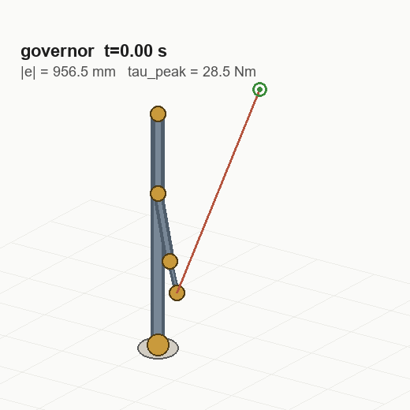
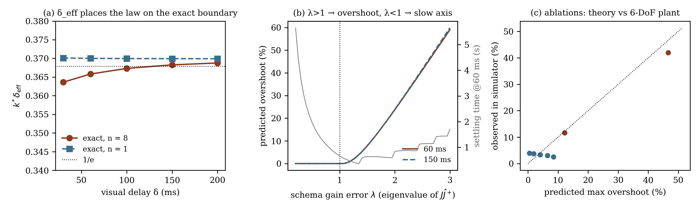

# robosimu — Oracle'sız görsel uzanma · Oracle-free visual reaching

[](https://github.com/iskenderozkul/robosimu/actions/workflows/tests.yml)
[](LICENSE)
[](https://iskenderozkul.github.io/robosimu/figures/human_arm_workbench.html)

> ### ▶ 3B robot simülasyonunu tarayıcıda açın · Open the 3D robot simulation in your browser
> **https://iskenderozkul.github.io/robosimu/figures/human_arm_workbench.html**
>
> Kurulum gerekmez. Tüm demolar: **https://iskenderozkul.github.io/robosimu/**
> Yedek bağlantı (GitHub Pages kapalıysa) · mirror: [raw.githack](https://raw.githack.com/iskenderozkul/robosimu/main/figures/human_arm_workbench.html)



**Dil / Language:** [Türkçe](#türkçe) · [English](#english)

---

## Türkçe

### Bu proje ne yapıyor?

Bir insan bardağa uzanırken eklem açılarını enkoderden okumaz, bardağa olan
mesafeyi santimetreyle hesaplamaz, kendi görme gecikmesini bir sayı olarak
bilmez. Görür, hareket eder, tekrar bakar, düzeltir.

Bu depo, aynı koşullarda çalışan bir robot kontrolcüsünü ve onu adil biçimde
sınayan bir simülatörü içerir. **Perceptual 1/e Governor** (Algısal 1/e
Yöneticisi) yalnızca iki kameradaki el ve hedefin **piksel koordinatlarını**
ve **zaman damgalarını** alır. Eklem açısını, analitik Jacobian'ı, metrik
mesafeyi ve gerçek gecikmeyi **hiç görmez**. Bu bir testle tip düzeyinde
denetlenir. Kendi görüntü Jacobian'ını ve servo gecikmesini 2,6 saniyelik bir
"agulama" (babbling) hareketiyle öğrenir ve şu kazancı uygular:

```
k = (1/e) / δ_eff ,    δ_eff = δ_obs + L + (n−1)T/2 + T/2
```

`δ_obs` zaman damgalarından ölçülen gecikme, `L` öğrenilen servo gecikmesi,
`(n−1)T/2` n karelik algısal ortalamanın grup gecikmesi, `T/2` örnekleme
tutmasıdır.

### Neden 1/e? (v6 teorisi)

Gecikmeli bir integratörde `k·δ ≤ 1/e`, aşmasız (monoton) yaklaşımın klasik
sınırıdır. v6'da bunu örneklenmiş döngü için **kesin olarak** hesapladık
([`robosimu/margin.py`](robosimu/margin.py),
[`reports/v6_margin_theory.md`](reports/v6_margin_theory.md)):

* n = 1 için kesin sınır `g* = dᵈ/(d+1)ᵈ⁺¹`'dir ve `k*(dT + T/2) → 1/e`.
* 8 karelik ortalamayla, kesin sınır ile yasanın kazancı 30–200 ms aralığında
  **%1,2 içinde** örtüşür (`k*·δ_eff = 0,364–0,369`). Yani `δ_eff` keyfi değildir:
  yasayı kesin sınırın **üzerine** yerleştirir.
* Öğrenilen Jacobian hatalıysa her mod, `M = J·Ĵ⁺` matrisinin bir özdeğeri λ
  ile ölçeklenir. **λ > 1 aşma**, **λ < 1 yavaş eksen** demektir. Bu tek
  mekanizma, gecikme terimi kaldırıldığında gözlenen aşmayı öngörür
  (60 ms: tahmin %12,2, gözlenen %11,6; 150 ms: %46,7 ve %41,9).



### Ana sonuç (6 eksenli kol, 12 bağımsız hedef × 2 gürültü tohumu)

| gecikme | oracle'sız (bu çalışma) | oracle'lı governor | 30 ms'de ayarlı PID |
|---|---|---|---|
| 30 ms  | %100 yerleşme, en büyük aşma %3,5 | %92, %18,6 | %83, %29,7 |
| 60 ms  | %100, %2,8 | %100, %9,9 | %58, %53 |
| 100 ms | %100, %2,0 | %100, %5,3 | %17, %135 |
| 150 ms | %100, %0,9 | %100, %3,7 | %0, %211 |
| 200 ms | %92 (iki tohumda aynı hedef, 6,1–6,3 mm), %0,6 | %100, %3,0 | %0, %251 |

**Bedeli:** oracle'sız yasa 60–200 ms'de oracle'lı governor'dan 2,0–3,1 kat
yavaştır. **Dürüst karşılaştırma:** bu kol için ayrı hedeflerde yeniden ayarlanan
sabit kazanç (k = 1,5 s⁻¹, oracle girdili) de aynı güvenilirlikte ve daha
hızlıdır. Zayıflığı bitkidir: servo 5 rad/s'ye yavaşlatılınca başarısı %75–88'e
düşer, oracle'sız yasa ise gecikmesini yeniden öğrenip %100'de kalır. Kesintili
(sakkadik) bakışta oracle'lı governor %69'a kadar aşar, oracle'sız yasa
efferent-kopya ileri modeliyle %3,1'in altında kalır.

### 3B simülasyon (tarayıcıda)

| demo | ne gösterir |
|---|---|
| [**İnsansı kol 3B laboratuvarı**](https://iskenderozkul.github.io/robosimu/figures/human_arm_workbench.html) | Sol göz · sağ göz · 3B sahne; üstten ve yandan görünüş; gövde dönüşü, bilek yönelimi, tek/çift göz, hareketli baş ve hareket paralaksı, tekillik ölçüsü; *Rastgele Hacim* ve *Çapraz Hacim* benchmark düğmeleri |
| [Altı eksenli kol görüntüleyici](https://iskenderozkul.github.io/robosimu/figures/arm_viewer.html) | Makalenin ana kolu, eklem kaydırıcıları |
| [Oracle'sız 1/e laboratuvarı (2B)](https://iskenderozkul.github.io/robosimu/figures/v5_oracle_free_lab.html) | Gecikme terimi, öğrenilen gecikme, Broyden ve c kazancıyla canlı ablasyon |

Laboratuvardaki diğer kontrolcüler metrik 3B geri çatım, gerçek gecikme ve eklem
açısı alır; tork ve enerji gibi bazı göstergeler basitleştirilmiş modellerdir.
Keşif içindir; makaledeki sayılar Python betiklerinden gelir.

### Tek komutla yeniden üretim

```bash
git clone https://github.com/iskenderozkul/robosimu.git
cd robosimu
pip install -e ".[dev]"
python scripts/run_v5.py                 # devam ettirilebilir; reports/v5_results.jsonl
python scripts/make_v5_figures.py        # figures/v5/*.png, reports/v5_summary_table.csv
python scripts/verify_margin_theory.py   # v6 teori şekli ve raporu (simülatör gerekmez)
pytest tests/test_margin.py tests/test_no_oracle_reach.py   # kabul kapısı
```

### Dürüst sınırlar

* **Yalnız simülasyon.** Motor modelleri katalog düzeyindedir; sürtünme ve
  boşluk (backlash) bir test düzeneğinden tanımlanmamıştır.
* Kesin sınır skaler, doğrusal bir döngü içindir. Gerçek bitkide hız/ivme
  sınırları ve Jacobian hatası vardır; teori bir **mekanizma** verir, ispat değil.
* Eklem sınırları ele alınmıyor: sınıra çarpan eklem öğrenilen Jacobian'ı geçersiz kılar.
* Tek göz, ancak boyut oranı biliniyorsa çalışır; %5 hata derinliği yanlış öğretir.

---

## English

### What this is

A person reaching for a cup does not read joint angles, does not compute the
distance in centimetres and does not know their own visual latency as a number.
This repository contains a controller that works under the same restrictions,
and a simulator that tests it fairly.

The **Perceptual 1/e Governor** (`robosimu/perceptual_governor.py`) receives
**only** the pixel coordinates of hand and target in two cameras plus
capture/arrival timestamps (`TimestampedObservation`). It never reads joint
angles, the analytic Jacobian, metric distances or the true delay; a test checks
the packet type and the controller interface. It learns its image Jacobian and
servo lag from a 2.6 s babbling routine and commands

```
k = (1/e) / δ_eff ,    δ_eff = δ_obs + L + (n−1)T/2 + T/2
```

### Why 1/e (v6 theory)

`k·δ ≤ 1/e` is the classical boundary between monotone and oscillatory decay of
a delayed integrator. v6 computes the **exact** boundary of the sampled loop
(`robosimu/margin.py`, `reports/v6_margin_theory.md`):

* for n = 1 the exact gain is `g* = d^d/(d+1)^(d+1)` and `k*(dT + T/2) → 1/e`;
* with 8-frame averaging the exact boundary and the law agree **within 1.2 %**
  over 30–200 ms (`k*·δ_eff = 0.364–0.369`), so `δ_eff` puts the law on the
  exact boundary rather than below it;
* a wrong body schema scales each closed-loop mode by an eigenvalue λ of
  `M = J Ĵ⁺`: **λ > 1 predicts overshoot, λ < 1 predicts a slow axis**. This
  single mechanism predicts the removed-delay ablation (60 ms: 12.2 % predicted
  vs 11.6 % observed; 150 ms: 46.7 % vs 41.9 %).

### Main result (six-axis arm, 12 independent targets × 2 noise seeds, 0.25 px noise)

| delay | oracle-free (this work) | governor with oracle | PID tuned @30 ms |
|---|---|---|---|
| 30 ms  | 100 % settle, max OS 3.5 % | 92 %, 18.6 % | 83 %, 29.7 % |
| 60 ms  | 100 %, 2.8 % | 100 %, 9.9 % | 58 %, 53 % |
| 100 ms | 100 %, 2.0 % | 100 %, 5.3 % | 17 %, 135 % |
| 150 ms | 100 %, 0.9 % | 100 %, 3.7 % | 0 %, 211 % |
| 200 ms | 92 % (same target fails on both seeds, 6.1–6.3 mm), 0.6 % | 100 %, 3.0 % | 0 %, 251 % |

**Price:** 2.0–3.1× slower than the oracle governor at 60–200 ms.
**Honest comparison:** a fixed gain retuned for this arm on separate tuning
targets (k = 1.5 s⁻¹, oracle inputs) is just as reliable (100 %, max overshoot
4.6–6.0 %) and faster. Its weakness is the plant: with the joint servo slowed to
5 rad/s and no retuning it drops to 75–88 % success and 11–14 % overshoot, while
the oracle-free law re-learns its lag (75 ms) and keeps 100 %. With intermittent,
saccade-like vision the oracle governor overshoots up to 69 %; the oracle-free
law with its efference-copy forward model stays at or below 3.1 %.
Details: `reports/v5_summary.md`, `reports/v5_tune_fixed.jsonl`,
`reports/v5_plant_shift.jsonl`, `reports/v5_intermittent_gaze.jsonl`.

### Interactive 3D simulation

| demo | what it shows |
|---|---|
| [**Human-like arm 3D workbench**](https://iskenderozkul.github.io/robosimu/figures/human_arm_workbench.html) | left eye · right eye · 3D scene; top and side views; trunk yaw, wrist orientation, one or two eyes, moving head with motion parallax, singularity measure; randomised-workspace benchmarks |
| [Six-axis arm viewer](https://iskenderozkul.github.io/robosimu/figures/arm_viewer.html) | the paper's main arm with joint sliders |
| [Oracle-free 1/e lab (2D)](https://iskenderozkul.github.io/robosimu/figures/v5_oracle_free_lab.html) | toggle the delay term, learned lag, Broyden and the gain c to see the ablation live |

The workbench UI is in Turkish. Its other controllers receive metric 3D
reconstructions, the true delay and joint angles, and some displayed quantities
(torque, energy) use simplified models; it is meant for exploration. Numbers in
the paper come from the Python scripts. Rebuild it with
`python -m robosimu workbench models/human_arm.json --out figures/human_arm_workbench.html`.

### Reproduce

```bash
git clone https://github.com/iskenderozkul/robosimu.git
cd robosimu
pip install -e ".[dev]"
python scripts/run_v5.py                 # resumable; writes reports/v5_results.jsonl
python scripts/make_v5_figures.py        # writes figures/v5/*.png and reports/v5_summary_table.csv
python scripts/verify_margin_theory.py   # v6 theory figure and report (no simulator needed)
pytest tests/test_margin.py tests/test_no_oracle_reach.py   # acceptance gate
```

Robustness, plant-shift, intermittent-gaze and encoderless runs:
`scripts/run_v5_robustness.py`, `scripts/run_v6_encoderless.py`.

### Repository layout

| path | content |
|---|---|
| `robosimu/perceptual_governor.py` | the oracle-free controller |
| `robosimu/margin.py` | exact-boundary theory (v6), pure NumPy |
| `robosimu/simulator.py` | two-rate plant: 1 kHz joint servo, 100 Hz delayed stereo vision; encoderless drive mode |
| `robosimu/stereo.py`, `v43.py` | pinhole stereo rig, neck, `TimestampedObservation` firewall |
| `robosimu/controllers.py` | fixed, adaptive, Smith, Broyden, PID, LQR, governor baselines |
| `robosimu/pulse_look.py` | look–pulse–brake controller for the encoderless plant |
| `models/` | `six_axis_arm.json`, `human_arm.json` (DH, masses, per-joint motors) |
| `scripts/` | experiment, figure and theory scripts |
| `reports/` | raw results (CSV/JSONL), summaries, statistics |
| `figures/` | paper figures and the interactive HTML simulations |
| `docs/` | design notes (Turkish): theory, assumptions, human speed profiles |

### The simulator in brief

Dependency-light (NumPy + Pillow; no ROS, PyBullet or SciPy): DH forward and
inverse kinematics; link-Jacobian Newton–Euler inverse dynamics; DC, BLDC and
stepper drive models with gearbox, current limit, torque ramp and regeneration;
a two-rate plant (1 kHz joint servo under a 15–100 Hz visual loop); delayed,
noisy stereo pixels; academic scenarios (delay, frame rate, anisotropic noise,
jitter, delay jumps, Fitts) with bootstrap and Wilson intervals, paired
permutation tests and Holm correction. Every joint of a model may carry a
different motor; see `models/README.md` for the JSON format.

```bash
python -m robosimu validate models/six_axis_arm.json
python -m robosimu simulate models/human_arm.json --posture hanging_natural \
    --target "0.45 0.0 1.10" --controller governor --delay 0.06 --gif figures/reach.gif
python -m robosimu scenarios models/six_axis_arm.json --out reports --seeds 5 --reaches 6 --jobs 8
python -m robosimu motor-compare models/six_axis_arm.json --out reports
```

### Limitations

* **Simulation only.** Motor models are datasheet-level; friction and backlash
  are not identified from a rig. No hardware validation is claimed.
* The exact boundary is for a scalar linear loop; the plant adds rate and
  acceleration limits and schema error. The theory gives a mechanism, not a proof.
* Joint limits are not handled: a joint at its limit invalidates the learned Jacobian.
* One-eye reaching works only when the size ratio is known; a 5 % error converges to the wrong depth.

### Citation

See [`CITATION.cff`](CITATION.cff). License: MIT ([`LICENSE`](LICENSE)).
